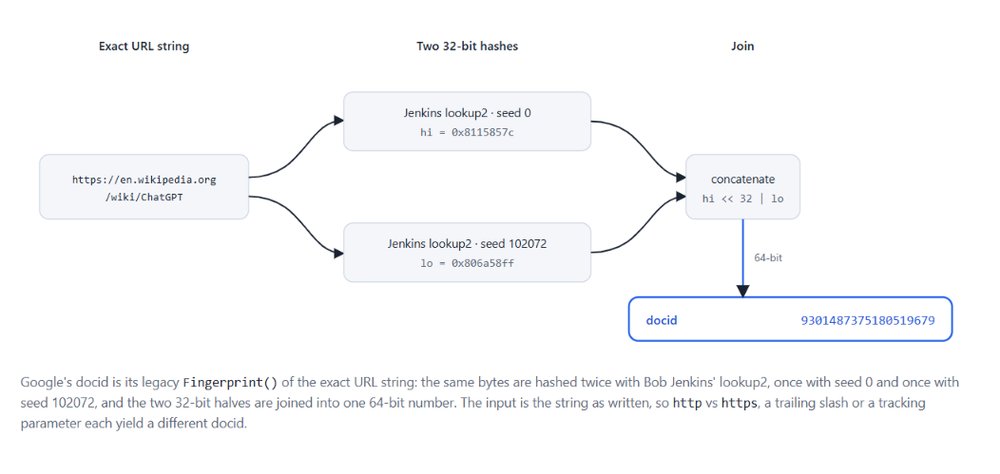

# Google DocID Research: Calculating Google's Internal Document Identifiers from URLs

Google Search identifies a web document with a 64-bit number, the **docid**. We found that this number
is not a counter assigned by the index: it is a fingerprint of the URL string, computed with a hash
function whose code has been public for years. Anyone can compute it.

```console
$ python docid.py https://en.wikipedia.org/wiki/ChatGPT
url             https://en.wikipedia.org/wiki/ChatGPT
docid unsigned  9301487375180519679
docid signed    -9145256698529031937
docid hex       8115857c806a58ff
page ID prefix  _1hqgHyFFY   (first 10 characters of a Google Images / Discover page ID)
```

## Key finding

```text
docid = (Jenkins32(url, seed = 0) << 32) | Jenkins32(url, seed = 102072)
```

`Jenkins32` is Bob Jenkins' 1996 *lookup2* hash, in the exact variant of Google's internal C++ library
(`gutil`), whose code is published under open-source licenses (Apache 2.0 and 3-clause BSD) in
[Apache Kudu](https://github.com/apache/kudu/tree/master/src/kudu/gutil/hash). The two seeds are the
library's default values for its legacy `Fingerprint()` function.

The function is applied to the URL **exactly as written**: scheme, `www`, trailing slash, query string,
letter case and percent-encoding are all part of the input.

| Evidence | Result |
|---|---|
| Google Search results data, 2023: the fingerprint of each displayed result's URL is a docid present in the same Google response | **49,767 / 49,767** results (28,898 distinct URL–docid pairs) |
| Independent re-check on 79 randomly drawn responses of the same corpus | 765 / 765 results |
| Page IDs on live Google Images result pages, October 2026 | 1,377 / 1,380 |
| Google Discover card identifiers, September–October 2026 | 1,482 / 1,545 distinct values resolved (96 %) |
| 30+ other hash functions and seed sets tested on 3,000 pairs (FarmHash, CityHash, Fingerprint2011, MurmurHash, FNV, truncated MD5/SHA, the "external" seeds of the same function) | 0 / 3,000 for each |

A random 64-bit match has a probability of about 1 in 1.8 × 10<sup>19</sup>. Every match is exact on all
64 bits.

## Why it matters

- **The docid is documented as a URL fingerprint, without saying which one.** Google's leaked Content
  Warehouse API documentation (2024) describes the field as
  *"64-bit docid of the document (usually fingerprint of URL, but not always)"*
  ([GDocumentBase](https://google-api-content-warehouse.hexdocs.pm/0.4.0/GoogleApi.ContentWarehouse.V1.Model.GDocumentBase.html)).
  This repository identifies which fingerprint, with which seeds, and shows that it is still in use.
- **It is a join key across Google products.** The same docid appears for the same URL in Search
  results, Google Images, Google Discover and Google News. A page can be followed from one surface to
  another without relying on how each surface writes its URL.
- **It shows which written form of a URL an identifier was computed from.** Each written form of an
  address has its own docid. When a Google page exposes a docid, you can test the variants of a URL and
  see which one it belongs to:
  `https` or `http`, with or without `/`, with or without tracking parameters. In Discover, for
  example, cards that displayed a URL with tracking parameters carried the docid of the bare URL.

What it does **not** do: a docid says nothing about the quality, ranking, age or crawl status of a page.
It is a hash of a string. Two pages of the same site have unrelated docids.

## Verify it yourself in two minutes

Google Images exposes page IDs in its result pages. The first 8 bytes of each ID are the docid of the
page the image comes from.

1. Search Google Images for any topic, right-click a result and choose *Inspect*.
2. On the result's container, read two attributes: `data-lpage` (the source page URL) and
   `data-ref-docid` (a 14-character ID).
3. Run both through the tool:

```console
$ python docid.py match DvLY3kr8C0KWkM https://en.wikipedia.org/wiki/Lockheed_Martin_F-22_Raptor
docid 4759174829743600142 (14-character page ID), 9 variants tested
MATCH  as given                     https://en.wikipedia.org/wiki/Lockheed_Martin_F-22_Raptor
```

That pair was read on a live Google Images page in October 2026 (attribute names as of that date; Google
can change them). If the URL in `data-lpage` contains HTML escapes such as `&amp;`, the `match` command
also tries the unescaped form.

## How it works



Google's `Fingerprint(s)` computes two 32-bit lookup2 hashes of the same bytes with two seeds and
concatenates them:

```text
hi = Hash32StringWithSeed(url_bytes, 0)
lo = Hash32StringWithSeed(url_bytes, 102072)
docid = hi << 32 | lo                    (unsigned 64-bit)
if hi == 0 and lo < 2: docid ^= 0x130f9bef94a0a928   (0 and 1 are reserved values)
```

Google's lookup2 differs from Bob Jenkins' reference `lookup2.c` in one detail: full 4-byte words,
including those in the final block, are read with **signed** bytes, for compatibility with Google's
earliest code (the library calls it "google1"); only the 1 to 3 leftover bytes that do not fill a word
are read unsigned. This only matters for bytes ≥ 0x80. In practice URLs are hashed in percent-encoded
ASCII form (see below), so both readings agree. The remapping of the reserved values 0 and 1 belongs to
the step that joins the two halves (`CombineFingerprintHalves`).

The same 64 bits can be written several ways. Google's own pages and data use more than one:

| Form | Example for `https://en.wikipedia.org/wiki/ChatGPT` |
|---|---|
| unsigned decimal | `9301487375180519679` |
| signed decimal (int64, e.g. Java `long`) | `-9145256698529031937` |
| hexadecimal | `8115857c806a58ff` |
| 14-character page ID (Images, Discover): the 8 bytes little-endian in URL-safe base64, followed by 14 more bits | starts with `_1hqgHyFFY` |

Only the first 10 characters of a page ID are fully determined by the docid. No function we tested
reproduces the extra 14 bits from the docid or the URL: they are the same for every image of a page and
differ between pages. We have not identified what they encode.

### The input is the exact string

The tool never normalizes a URL. These five written forms of one address have five different docids:

| URL | docid |
|---|---|
| `https://en.wikipedia.org/wiki/ChatGPT` | 9301487375180519679 |
| `https://en.wikipedia.org/wiki/ChatGPT/` | 13583687203501448240 |
| `http://en.wikipedia.org/wiki/ChatGPT` | 7744124899370780516 |
| `en.wikipedia.org/wiki/ChatGPT` | 15712342959762046648 |
| `https://en.m.wikipedia.org/wiki/ChatGPT` | 5115253021112119761 |

**Non-ASCII characters.** Every identifier we resolved for a URL containing non-ASCII characters (95
cases) matched the percent-encoded UTF-8 form (`%C3%89`, upper-case hex), never the raw Unicode
string. When the input contains non-ASCII characters, the tool hashes it as given and prints the
percent-encoded result next to it as a note.

## Installation

Python 3.10 or later, standard library only. There is nothing to install.

```console
git clone https://github.com/OliSeg/google-docid-research.git
cd google-docid-research
python docid.py https://example.com/
```

## Usage

```console
python docid.py URL [URL ...]           # docid of each exact string
python docid.py variants URL            # docids of common written forms of a URL
python docid.py decode ID               # read a decimal, signed, hex or 14-character page ID
python docid.py match ID URL [URL ...]  # which form of which URL produces this docid
python docid.py --json ...              # machine-readable output
python docid.py -- STRING               # hash a string that looks like a command or option
```

`match` exits with status 0 when a variant matches and 1 when none does, so it can be used in scripts.
The variants it tries are listed by `variants`: scheme, `www`, trailing slash, without query and
without fragment, in all combinations, applied to the URL as given and, when relevant, to its `&amp;`
unescaped, percent-encoded or `https://`-prefixed form; plus the whole URL in lowercase.

As a library:

```python
from docid import docid, to_signed, decode_page_id

docid("https://en.wikipedia.org/wiki/ChatGPT")   # 9301487375180519679
to_signed(9301487375180519679)                   # -9145256698529031937
decode_page_id("DvLY3kr8C0KWkM")                 # 4759174829743600142
```

Tests: `python -m unittest -v test_docid` (35 tests, standard library only).

## Validation

**Experimentally validated**

- 2023 Google Search results data: for every displayed result, the fingerprint of its URL equals a
  docid present in the same Google response. 49,767 of 49,767 results, 28,898 distinct URL–docid
  pairs, no exception. An independent re-check on 79 randomly drawn responses of the same corpus
  confirmed 765 of 765 results.
- Google's source code lists two collisions of `Fingerprint()`: `"01056/02"` / `"11057/02"` and
  `"LTA 02"` / `"MTA 12"`. This implementation reproduces both with the seeds 0 and 102072, and with none
  of the other seeds tested. This check uses no data of ours.
- 2026: Google Images page IDs (1,377 / 1,380 on live result pages), Google Discover card identifiers
  (1,482 / 1,545 distinct values), Google News article docids (54), docids of videos on Google's store
  pages for merchants (26 / 26) and the docids listed in the data of a live Search results page (7 / 10; the
  URLs of the other 3 were not in the captured data).

**Not shown**

- that every Google identifier is a URL fingerprint. Shopping offer and product IDs, Maps place IDs
  (CID), and Gemini's source identifiers are not (see [RESEARCH.md](RESEARCH.md));
- how Google stores, indexes or ranks documents;
- that the docid is the only key of a document. The same `DocId` field description in Google's
  documentation warns that it *"does NOT uniquely identify a document ANYMORE"*.

## Scope and limitations

- **Only some identifiers.** The formula is demonstrated for the docids of web documents in Google
  Search, Images, Discover and News. Do not assume it for other products or identifier types.
- **Not a ranking signal.** A docid is a hash of a string. It carries no information about the page.
- **Representation matters.** A different scheme, host, slash, query, case or encoding gives a
  different docid. A docid can only be traced back to its URL by testing candidate URLs; the function
  cannot be inverted.
- **Gemini is different.** The `docid` attached to sources in Gemini responses is not this
  fingerprint (0 matches on 85,485 URL–identifier pairs). It was issued anew for each response, even
  for unchanged pages. See [RESEARCH.md](RESEARCH.md#6-gemini-a-separate-case).
- **Internal architecture.** Matching an identifier does not tell us how Google's systems are built.
  We describe what can be observed and computed, and label interpretations as such.
- **Collisions.** Google's code warns that this fingerprint has excess collisions. Do not use it as a
  unique or security identifier.

## Technical background

- **Algorithm.** Bob Jenkins, *lookup2* (1996), public domain:
  [burtleburtle.net/bob/hash/evahash.html](http://burtleburtle.net/bob/hash/evahash.html).
- **Google's implementation.** `gutil` hash library, published in Apache Kudu:
  [`hash.cc`](https://github.com/apache/kudu/blob/master/src/kudu/gutil/hash/hash.cc),
  [`hash.h`](https://github.com/apache/kudu/blob/master/src/kudu/gutil/hash/hash.h),
  [`jenkins.cc`](https://github.com/apache/kudu/blob/master/src/kudu/gutil/hash/jenkins.cc),
  [`jenkins_lookup2.h`](https://github.com/apache/kudu/blob/master/src/kudu/gutil/hash/jenkins_lookup2.h).
  The seeds sit next to this comment in `hash.cc`:

  ```text
  // For components that ship code externally (notably the Google Search
  // Appliance) we want to change the fingerprint function so that
  // attackers cannot mount offline attacks to find collisions with
  // google.com internal fingerprints (most importantly, for URL
  // fingerprints).
  // [...]
  #ifdef EXTERNAL_FP
  static const uint32 kFingerprintSeed0 = 0xabc;
  static const uint32 kFingerprintSeed1 = 0xdef;
  #else
  static const uint32 kFingerprintSeed0 = 0;
  static const uint32 kFingerprintSeed1 = 102072;
  #endif
  ```

  In our test on 3,000 URL–docid pairs, the "external" seeds matched none and the internal seeds
  matched all.
- **Test vectors.** Mozc, Google's input method, ships its own port of this hash with published test
  values ([`src/base/hash_test.cc`](https://github.com/google/mozc/blob/master/src/base/hash_test.cc)).

The fingerprint algorithm is not new. Our contribution is showing that Google Search docids are this
fingerprint of the URL, validating it on real Google data, and providing a tested implementation.

## Citation

```text
Olivier de Segonzac, Resoneo. Google DocID Research: Calculating Google's Internal Document
Identifiers from URLs. 2026. https://github.com/OliSeg/google-docid-research
```

GitHub also offers a "Cite this repository" entry generated from [CITATION.cff](CITATION.cff).

Author: Olivier de Segonzac ([Resoneo](https://think.resoneo.com)). More research at
[think.resoneo.com](https://think.resoneo.com).

## License

MIT, see [LICENSE](LICENSE). `docid.py` is an independent Python implementation of a public-domain
algorithm, following the behavior of Google's `gutil` code (Apache 2.0); see the notices in [LICENSE](LICENSE).

## Disclaimer

This is independent research. It is not affiliated with, sponsored or endorsed by Google. Google,
Google Search, Google Images, Google Discover, Google News and Gemini are trademarks of Google LLC.
